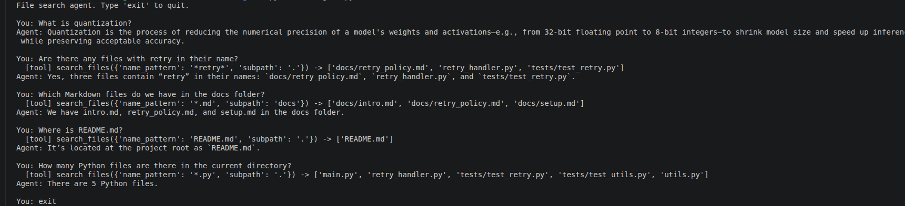

# File Search Agent

A command-line agent that answers questions about files in a folder. It searches the files when it needs to, and answers normally for greetings or general questions.

I built this during the Nebius Academy Agentic AI course, using models from Nebius Token Factory.



## How it works

1. You ask a question.
2. The model decides if it needs to search. If yes, it replies with a JSON tool call.
3. Python reads the JSON and runs `search_files`.
4. The result is sent back to the model, which gives the final answer.

The conversation history is kept, so follow-up questions work and the agent doesn't search again for things it already found. If the model replies without a tool call, or the tool returns an error, the program handles it instead of crashing. The search tool only works inside `sample_workspace/`.

## Project structure

```
file-search-agent/
├── src/
│   ├── tools.py
│   ├── agent.py
│   └── benchmark.py
├── sample_workspace/
├── results.csv
└── requirements.txt
```

## Setup

```bash
git clone https://github.com/nanbont/file-search-agent.git
cd file-search-agent
python3 -m venv .venv
source .venv/bin/activate
pip install -r requirements.txt
```

Add your Token Factory API key to a `.env` file in the project root:

```
NEBIUS_API_KEY=your-key-here
```

## Usage

```bash
python src/agent.py
```

Example questions:

- How many Python files are there?
- Which Markdown files do we have in the docs folder?
- Where is README.md?
- Are there any files with retry in their name?

Type `exit` to quit.

## Benchmark

I compared three Nemotron 3 models. Each one answered the same 6 questions 3 times. These are the averages per question:

| Model | E2E latency | TTFT | Input tokens | Output tokens | Cost per request | Correct tool use | Repeated calls |
|---|---|---|---|---|---|---|---|
| Nano 30B | 3.56 s | 1.17 s | 453 | 190 | $0.000073 | 18/18 | 0/3 |
| Super 120B | 1.61 s | 0.61 s | 454 | 137 | $0.000259 | 18/18 | 0/3 |
| Ultra 550B | 1.23 s | 0.60 s | 452 | 102 | $0.000758 | 18/18 | 0/3 |

All three models used the tool when they should and never searched twice for the same thing. Nano was the slowest even though it's the smallest, because it produced the most output tokens. Ultra was the fastest but costs about 10 times more than Nano. For this task Nano is good enough and the cheapest.

The test is small and latency depends on server load, so the numbers will change between runs. Full results are in `results.csv`.

To run the benchmark:

```bash
python src/benchmark.py
```